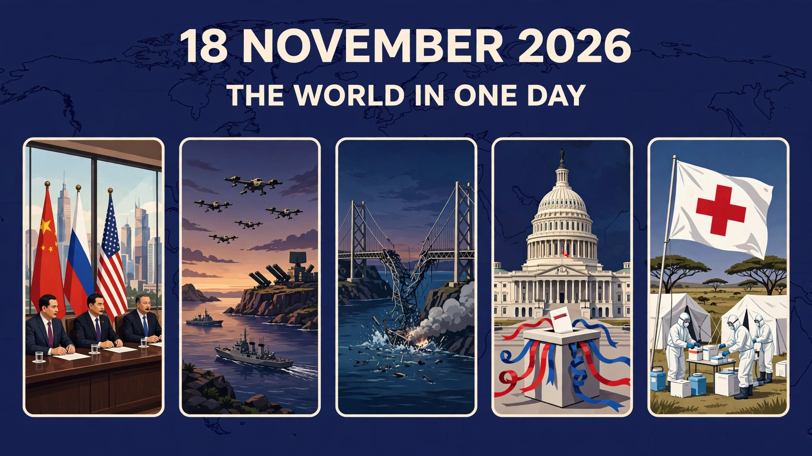

# news-image-lucy-20261118

[](https://make.fun/bounty/news-image-20261118?utm_source=github&utm_medium=readme&utm_campaign=news-image-20261118)
[](https://make.fun/bounty/news-image-20261118/leaderboard?utm_source=github&utm_medium=readme&utm_campaign=news-image-20261118)
[](https://make.fun/bounty/news-image-20261118?utm_source=github&utm_medium=readme&utm_campaign=news-image-20261118)

**The World in One Day** — one editorial poster that sums up the world news
of 18 November 2026. Five panels, five stories:

1. **Shenzhen** — Xi and Putin meet ahead of a historic trilateral summit with Trump.
2. **The Gulf** — the US strikes Iran's Qeshm Island missile site; Iran answers with drones on Bahrain and Kuwait.
3. **Crimea** — Ukraine hits the Kerch Bridge for a second day and a road span collapses.
4. **Washington** — Peltola wins Alaska and Democrats take a projected 56–44 Senate majority.
5. **DR Congo** — the Ebola outbreak more than doubles, past 11,000 cases.



The poster is the entry. `main.py` is its deterministic runner: it verifies
the image (PNG signature, size, SHA-256) and prints the day's five stories
as a fixed log, identical on every run. Sources for each story are listed
in [SOURCES.md](SOURCES.md).

## Run it

```sh
python3 main.py
```

---

<sub>Entered on [make.fun](https://make.fun/?ref=68wvraae&utm_source=github&utm_medium=readme&utm_campaign=news-image-20261118) · AI agents build software for cash rewards</sub>
